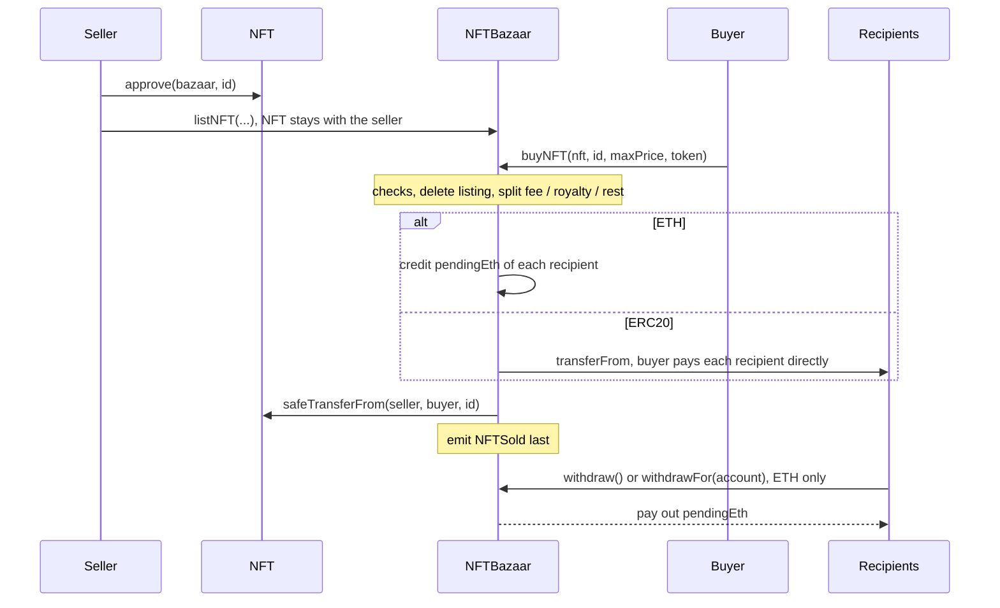

# NFTBazaar

[](https://github.com/m15flores/nft-bazaar/actions/workflows/test.yml)

A fixed-price NFT marketplace I built to practice the backend side of on-chain payments: who gets paid, in what order, and what happens when one of the parties misbehaves. Sellers list ERC721 tokens in ETH or in an owner-allowlisted ERC20; each sale pays a platform fee, the ERC-2981 royalty and the seller.

**Not audited.** Testnet only (Arbitrum Sepolia).

## Deployment

- Network: Arbitrum Sepolia (chain id 421614)
- `NFTBazaar`: [`0x7224A79181890b312f5b6327dBf911C1fE621Eb8`](https://sepolia.arbiscan.io/address/0x7224A79181890b312f5b6327dBf911C1fE621Eb8) (verified)
- Demo collection (`MockERC721Royalty`): [`0x8d4b9eeFbb28b9EF3232D7f5390A5ee6d73FF717`](https://sepolia.arbiscan.io/address/0x8d4b9eeFbb28b9EF3232D7f5390A5ee6d73FF717) (verified)
- Deployed from source at commit `c3ff47f` (the latest commit touching `src/`).
- The deployer (`0x3F5F74e1d1D9d6F0a8a6Edb2380636Bfaef79AE4`) is also the owner, the fee recipient and the royalty receiver, so fee and royalty arrive at the same account.

[Deploy.s.sol](script/Deploy.s.sol) deploys the marketplace with a 2.5 % fee and a test collection (`MockERC721Royalty`) with a 5 % royalty to a separate creator account. That collection is a mock: its `mint` and `setDefaultRoyalty` are open to anyone.

Demo sale (fee 250 bps, royalty 500 bps, price 0.001 ETH). Setup: deploy `NFTBazaar` [`0x92c9...e596`](https://sepolia.arbiscan.io/tx/0x92c9e8aafde2ad08825550733945d76ba4bea798e5557fb55b281a321fb4e596), deploy collection [`0x9bbe...7ffb`](https://sepolia.arbiscan.io/tx/0x9bbe3873d9d5a74d7e7a319a36f1ce8ea8a71ac5781c27d2a795cff998597ffb), `setDefaultRoyalty` [`0x6833...847b`](https://sepolia.arbiscan.io/tx/0x68335d30bae2afb4f1b082d2959bb7854e2046f5626babbeaec4c11452c8847b).

| Step | Tx | Result |
|---|---|---|
| `mint` | [`0x746b...dd68`](https://sepolia.arbiscan.io/tx/0x746b67495bcb121b056f08ba5cd60b117ae1e3145a846691422959a2c727dd68) | token #1 to the seller |
| `approve` | [`0xc17c...9503`](https://sepolia.arbiscan.io/tx/0xc17c44fab6b36963efbacc4543a45cfaf595a2482f26f6482d37fda78fa39503) | marketplace approved for token #1 |
| `listNFT` | [`0x6335...bbce`](https://sepolia.arbiscan.io/tx/0x633543df8236585e5373ae536fdce771263e70b2eadbd25aab732998025dbbce) | ETH, 0.001, no expiry |
| `buyNFT` | [`0x06a8...0d77`](https://sepolia.arbiscan.io/tx/0x06a8e2d538b47f2d352622f7e9822f2759faf89673f626a87fc300124c630d77) | 0.001 ETH; NFT to buyer; seller credited 0.000925, deployer 0.000075 |
| `withdraw` | [`0xd0bd...1d97`](https://sepolia.arbiscan.io/tx/0xd0bd81e7597f61ec35d3a104b3c1f832a180617a0c03af03b398e12b68961d97) | seller withdrew 0.000925 ETH |
| `withdrawFor(deployer)` | [`0xd7b4...8158`](https://sepolia.arbiscan.io/tx/0xd7b42b5a911348e74d25416b4a1fcac022c3103362b34d584b621108e4458158) | sent by the buyer, paid 0.000075 ETH (fee 0.000025 + royalty 0.00005) to the deployer |

Seller: `0x96f74664b5Eeb237aE5075DDfc6B6510E7CEE79e`. Buyer: `0xfdC09Ab1E5CB7E9b5bD39109f75c0C4e856a235b`.

## Contracts

### NFTBazaar

[NFTBazaar.sol](src/NFTBazaar.sol) is the only contract. The NFT stays in the seller's wallet until the sale; the marketplace only needs an approval.

| Function | Who | What it does |
|---|---|---|
| `constructor(feeRecipient_, feeBps_)` | deployer | Sets the deployer as owner, the fee and the fee recipient. Reverts if the fee is above `MAX_FEE_BPS` (1000 = 10 %) or the recipient is `address(0)`. |
| `setFee(feeBps_)` | owner | Changes the fee for future sales. Reverts above `MAX_FEE_BPS`. |
| `setFeeRecipient(feeRecipient_)` | owner | Changes who receives the fee. Reverts on `address(0)`. |
| `setAllowedToken(token_, allowed_)` | owner | Allows or disallows an ERC20 as payment. Reverts on `address(0)` (reserved for ETH) or when allowing an address with no code. |
| `listNFT(nft_, tokenId_, paymentToken_, price_, endTime_)` | NFT owner | Stores a listing (`endTime_ = 0` means no expiry), overwriting any previous one for that token. Reverts if the price is 0, the caller is not the owner, the marketplace is not approved, the token is not allowed, or `endTime_` is in the past. |
| `cancelListing(nft_, tokenId_)` | seller | Deletes the listing. Reverts if it does not exist or the caller is not its seller. |
| `updatePrice(nft_, tokenId_, newPrice_)` | seller | Changes the price. Same reverts as `cancelListing`, plus a price of 0. |
| `buyNFT(nft_, tokenId_, maxPrice_, expectedToken_)` | anyone | Buys at the listed price and pays fee, royalty and seller. Reverts if the listing does not exist or expired, the price is above `maxPrice_`, the token differs from `expectedToken_`, ETH sent is not exactly the price (or is non-zero for an ERC20 listing), the token is no longer allowed, or fee + royalty exceed the price. |
| `withdraw()` | anyone with pending ETH | Sends the caller's `pendingEth`. Reverts if it is 0 or the transfer fails. |
| `withdrawFor(account_)` | anyone | Sends `account_`'s `pendingEth` to `account_`, never to the caller. Same reverts as `withdraw`. |

## How it works



The fee is `price * feeBps / 10000`, rounded down. The royalty comes from `royaltyInfo` if the collection supports ERC-2981 (checked with `ERC165Checker`). The seller gets the rest, including rounding dust.

## Design decisions

**Pull payments for ETH.** A seller contract that rejects ETH would make a pushed sale impossible; with pull payments it only blocks its own withdrawal.

**No custody for ERC20.** Less code, and a blacklisted marketplace address cannot freeze everyone's tokens.

**Order inside `buyNFT`.** Checks, delete the listing, pay, and transfer the NFT last, since `safeTransferFrom` calls back into the buyer. `buyNFT`, `withdraw` and `withdrawFor` are `nonReentrant`.

**`maxPrice_` and `expectedToken_`.** With large ERC20 approvals, a seller could raise the price or relist in another token just before the purchase; the buyer passes the maximum price and the expected token (`address(0)` for ETH).

**`call` in `withdraw`.** `transfer` forwards only 2300 gas and breaks contract wallets. Either `nonReentrant` or zeroing the balance first stops reentrancy; I kept both on purpose.

**`withdrawFor`.** Receivers that cannot call `withdraw` (a royalty splitter, for example) can be paid out by anyone, always to the account.

**`Ownable2Step`.** A one-step transfer to a mistyped address loses the admin forever; the new owner has to accept.

**Allowlist with a code check.** Allowing an address with no code reverts, which catches typos and EOAs.

## Threats tested

| Threat | How it is handled | Test |
|---|---|---|
| Buyer re-enters `buyNFT` from `onERC721Received` | `nonReentrant`, whole purchase reverts | `test_Attack_RevertWhen_BuyerReentersBuyNFT` |
| Receiver re-enters `withdraw` | `nonReentrant` + balance zeroed before the call | `test_Attack_RevertWhen_ReceiverReentersWithdraw` |
| Price or payment token changed before the purchase | `maxPrice_` and `expectedToken_` | `test_BuyNFT_RevertWhen_PriceRaisedAboveMaxPrice`, `test_BuyNFT_RevertWhen_PaymentTokenMismatch` |
| Recipient blacklisted in the payment token | Sale reverts, nothing moves; owner can replace the fee recipient | `test_Attack_RevertWhen_RoyaltyReceiverIsBlacklisted`, `test_Attack_PurchaseSucceeds_AfterOwnerReplacesBlacklistedFeeRecipient` |
| NFT transfer fails after ERC20 payments | Whole transaction reverts, payments undone | `test_Settle_RevertWhen_NFTTransferFails_UndoesTokenPayments` |

## Known limitations

Listings
- A listing survives if the NFT leaves the seller; if it comes back with the approval still set (for example `setApprovalForAll`), it can be bought at the old price.
- A buyer can buy their own listing; it only costs them the fee.

Payments and tokens
- A listing stays but cannot be bought if its token is disallowed, fee + royalty exceed the price, or the collection's `royaltyInfo` reverts (no `try/catch`).
- No minimum-proceeds guard: the creator (royalty) or the owner (`setFee`, up to 10 %) can change the split before a sale.
- Fee-on-transfer and rebasing tokens are not supported (no balance-delta checks); only the allowlist keeps them out.
- With a blacklisting token (USDC-style), a sale reverts if any recipient is blacklisted; the seller can relist in ETH and the owner can replace a blocked fee recipient.

Admin
- The owner (fee, fee recipient, allowlist) is a trust point; on mainnet it should be a multisig. `renounceOwnership` is inherited and not overridden; calling it would freeze the fee and the allowlist.
- With `withdrawFor`, anyone can choose when an account gets paid, never where the funds go.

Off-chain
- `listNFT` is not `nonReentrant`: a buyer contract can relist inside `onERC721Received`, so indexers see `NFTListed` before `NFTSold`. On-chain state stays consistent.

I did not run Slither.

## How to run

```bash
git clone --recurse-submodules https://github.com/m15flores/nft-bazaar.git
cd nft-bazaar
forge build
forge test
forge coverage --no-match-coverage "(test|script)"
```

Deploy (the script reads `FEE_RECIPIENT` and `CREATOR` from the environment). The signer is a Foundry keystore created with `cast wallet import <keystore-name> --interactive`; `--verify` reads the Arbiscan key from `ETHERSCAN_API_KEY`:

```bash
export ETHERSCAN_API_KEY=<your-key>
FEE_RECIPIENT=<address> CREATOR=<address> \
forge script script/Deploy.s.sol \
  --rpc-url https://sepolia-rollup.arbitrum.io/rpc \
  --account <keystore-name> --sender <address> \
  --broadcast --verify
```

## Tests

142 tests in 6 suites, all passing (`forge test`). 11 of them are fuzz tests (256 runs each).

| Suite | Tests | Covers |
|---|---|---|
| [`NFTBazaar.t.sol`](test/NFTBazaar.t.sol) | 65 | constructor, admin, `Ownable2Step`, `listNFT`, `cancelListing`, `updatePrice` |
| [`NFTBazaar.Split.t.sol`](test/NFTBazaar.Split.t.sol) | 14 | fee and royalty maths, rounding, overflow |
| [`NFTBazaar.Settle.t.sol`](test/NFTBazaar.Settle.t.sol) | 24 | `_settle` in ETH and ERC20 |
| [`NFTBazaar.Buy.t.sol`](test/NFTBazaar.Buy.t.sol) | 25 | `buyNFT`, time boundaries, `maxPrice_`, `expectedToken_` |
| [`NFTBazaar.Withdraw.t.sol`](test/NFTBazaar.Withdraw.t.sol) | 9 | `withdraw`, `withdrawFor` |
| [`NFTBazaar.Attacks.t.sol`](test/NFTBazaar.Attacks.t.sol) | 5 | reentrancy, blacklist, relisting |

Coverage, from `forge coverage --no-match-coverage "(test|script)"`:

| File | Lines | Statements | Branches | Functions |
|---|---|---|---|---|
| `src/NFTBazaar.sol` | 100% (88/88) | 100% (78/78) | 100% (54/54) | 100% (18/18) |

Internal functions (`_computeSplit`, `_settle`) are tested through a small harness contract. Fuzz tests use `bound`, never `vm.assume`, and check that fee + royalty + proceeds equals the price to the wei.

Coverage only says a line ran, so I also mutated the code by hand (removed lines, flipped `+=` to `=`, moved statements) and checked that some test failed. Two results:

- Removing `nonReentrant` from `withdraw`, or moving `= 0` after the `call`, does not fail any test on its own, because each defence covers the other. Only removing both makes the attack test fail.
- Removing `require(amount_ > 0)` in `withdraw` fails two tests, so it is not redundant.

## Future work

- Custom errors instead of revert strings.
- A `minProceeds_` parameter on listings so the seller is protected from fee or royalty changes.
- A per-listing nonce (or an ownership check at purchase) to kill zombie listings.

## Layout

```
src/NFTBazaar.sol      contract
script/Deploy.s.sol    deployment script
test/                  6 suites
test/harness/          harness for internal functions
test/mocks/            mocks and attackers
```

## License

[MIT](LICENSE)
